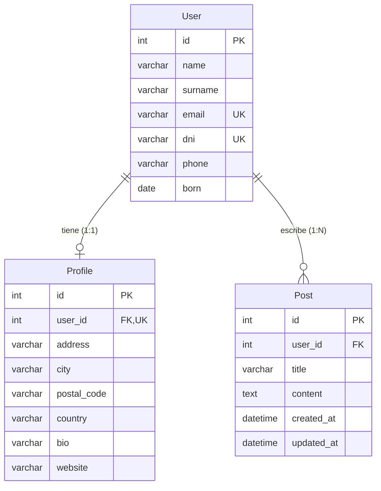

# php-api

API REST en **PHP puro** (sin frameworks) con **PDO + MySQL**, pensada como ejemplo didáctico de una arquitectura limpia y de cómo modelar **relaciones entre entidades**:

- **1 a 1**: un `User` tiene como máximo un `Profile`.
- **1 a N**: un `User` puede tener muchos `Post`.

## Características

- Arquitectura por capas: **Router → Controller → Repository → Model**, con inyección de dependencias manual.
- Autoloading **PSR-4** con Composer (`App\` → `src/`).
- Consultas **preparadas** con PDO (sin concatenar datos del usuario en el SQL).
- **Validación** de entradas con mensajes de error por campo (incluye validación de DNI español con letra de control).
- **Relaciones** con integridad referencial en base de datos (`FOREIGN KEY`, `UNIQUE`, `ON DELETE CASCADE`).
- Carga de relaciones bajo demanda con `?include=profile,posts` (sin el problema N+1).
- Creación de un usuario **junto con su perfil y sus posts** en una sola petición, dentro de una **transacción**.
- **Paginación** en los listados (`?page=`, `?per_page=`).
- Respuestas JSON con formato uniforme y **códigos HTTP correctos** (201, 404, 409, 422...).
- Configuración mediante **variables de entorno** / fichero `.env` (las credenciales ya no están en el código).
- CORS opcional.

## Requisitos

- PHP **8.1** o superior con las extensiones `pdo_mysql`, `mbstring` y `json`
- MySQL 5.7+ o MariaDB 10.3+
- [Composer](https://getcomposer.org/) (solo para generar el autoloader; el proyecto no tiene dependencias externas)
- Apache con `mod_rewrite` (opcional: también puedes usar el servidor integrado de PHP)

## Instalación

```bash
# 1. Clonar e instalar (genera vendor/autoload.php)
git clone https://github.com/rusben/php-api.git
cd php-api
composer install

# 2. Crear la base de datos y las tablas
mysql -u root -p < src/db/schema.sql

# 3. (Opcional) Cargar datos de ejemplo
mysql -u root -p api < src/db/seed.sql

# 4. Configurar credenciales
cp .env.example .env
#    -> edita .env con tu usuario y contraseña de MySQL

# 5. Arrancar el servidor de desarrollo
composer start
#    -> http://localhost:8000/api/
```

Comprueba que funciona:

```bash
curl http://localhost:8000/api/
curl http://localhost:8000/api/users?include=profile,posts
```

> **¿Ya tenías la versión anterior?** `schema.sql` es idempotente (`CREATE TABLE IF NOT EXISTS`):
> puedes ejecutarlo sobre tu base de datos existente y solo creará las tablas nuevas `Profile` y `Post`,
> sin tocar tus usuarios. La tabla `User` se mantiene compatible (los campos `text` antiguos siguen funcionando).

### Configuración (`.env`)

| Variable      | Por defecto | Descripción                                                                 |
|---------------|-------------|-----------------------------------------------------------------------------|
| `APP_DEBUG`   | `false`     | Incluye el detalle de los errores 500 en la respuesta. No usar en producción. |
| `BASE_PATH`   | `/api`      | Prefijo de URL bajo el que se sirve la API.                                 |
| `DB_HOST`     | `localhost` | Host de MySQL.                                                              |
| `DB_PORT`     | `3306`      | Puerto de MySQL.                                                            |
| `DB_NAME`     | `api`       | Nombre de la base de datos.                                                 |
| `DB_USER`     | `usuario`   | Usuario de MySQL.                                                           |
| `DB_PASS`     | `password`  | Contraseña de MySQL.                                                        |
| `CORS_ORIGIN` | *(vacío)*   | Origen permitido para CORS (`*` o una URL). Vacío = CORS desactivado.       |

Las variables de entorno reales tienen prioridad sobre el fichero `.env`.

### Despliegue con Apache

Apunta el `DocumentRoot` a la carpeta `public/` y habilita `mod_rewrite` (`a2enmod rewrite`):

```apache
<VirtualHost *:80>
    DocumentRoot /var/www/php-api/public

    <Directory /var/www/php-api/public>
        AllowOverride All
        Require all granted
    </Directory>
</VirtualHost>
```

El archivo `public/api/.htaccess` redirige todas las peticiones a `public/api/index.php`.
La API quedará disponible en `http://tu-dominio/api/...`.

Con **Nginx** basta con enviar todo lo que cuelga de `/api/` al front controller (junto con tu bloque habitual de PHP-FPM):

```nginx
location /api/ {
    try_files $uri /api/index.php?$query_string;
}
```

## Estructura del proyecto

```text
php-api/
├── public/
│   └── api/
│       ├── .htaccess            # Reescritura de URLs (Apache)
│       └── index.php            # Front controller: único punto de entrada
├── src/
│   ├── Application.php          # Rutas, construcción de controladores y gestión de errores
│   ├── Config/
│   │   └── Config.php           # Lectura de variables de entorno / .env
│   ├── Database/
│   │   └── Database.php         # Conexión PDO (perezosa, una por petición)
│   ├── Http/
│   │   ├── ApiException.php     # Errores controlados con código HTTP
│   │   ├── Request.php          # Petición: ruta, JSON, paginación, include
│   │   ├── Response.php         # Respuesta JSON uniforme
│   │   └── Router.php           # Enrutado método + patrón → controlador
│   ├── Model/
│   │   ├── User.php             # Entidad User (con relaciones Profile y Posts)
│   │   ├── Profile.php          # Entidad Profile (1:1)
│   │   └── Post.php             # Entidad Post (1:N)
│   ├── Repository/              # Acceso a datos (SQL con consultas preparadas)
│   │   ├── UserRepository.php
│   │   ├── ProfileRepository.php
│   │   └── PostRepository.php
│   ├── Validation/
│   │   └── Validator.php        # Validación y normalización de entradas
│   ├── Controller/
│   │   ├── UserController.php
│   │   ├── ProfileController.php
│   │   └── PostController.php
│   └── db/
│       ├── schema.sql           # Tablas, claves e índices
│       └── seed.sql             # Datos de ejemplo
├── requests.http                # Colección de peticiones de ejemplo
├── .env.example
├── composer.json
└── README.md
```

**Flujo de una petición:**

```text
HTTP → public/api/index.php → Application → Router → Controller → Validator
                                                          │
                                                          └→ Repository → PDO → MySQL
                                                          ↓
                                  Model::toArray() → Response (JSON)
```

## Modelo de datos



| Relación         | Cómo se implementa                                                                  |
|------------------|-------------------------------------------------------------------------------------|
| `User` 1 — 0..1 `Profile` | `Profile.user_id` es **UNIQUE** y clave foránea: la base de datos impide dos perfiles para el mismo usuario. |
| `User` 1 — 0..N `Post`    | `Post.user_id` es clave foránea **sin** restricción de unicidad.                 |
| Borrado          | `ON DELETE CASCADE`: al borrar un usuario se borran su perfil y sus posts.          |

En el código, la clase `User` conserva sus relaciones (`setProfile()`, `setPosts()`) y solo las serializa si se han cargado. Así se distingue entre *"no cargado"* (la clave no aparece) y *"cargado y vacío"* (`"profile": null` o `"posts": []`).

## Referencia de la API

URL base: `http://localhost:8000/api` (según `BASE_PATH`). Todas las peticiones con cuerpo usan `Content-Type: application/json`.

### Endpoints

| Método | Ruta                       | Descripción                                                     | Éxito |
|--------|----------------------------|-----------------------------------------------------------------|-------|
| GET    | `/`                        | Información de la API                                           | 200   |
| GET    | `/users`                   | Lista usuarios (paginado, admite `?include=`)                   | 200   |
| POST   | `/users`                   | Crea un usuario (admite `profile` y `posts` anidados)           | 201   |
| GET    | `/users/{id}`              | Obtiene un usuario (admite `?include=`)                         | 200   |
| PUT / PATCH | `/users/{id}`         | Actualiza **solo los campos enviados**                          | 200   |
| DELETE | `/users/{id}`              | Borra el usuario, su perfil y sus posts                         | 200   |
| GET    | `/users/{id}/profile`      | Obtiene el perfil del usuario                                   | 200   |
| PUT / PATCH | `/users/{id}/profile` | Crea el perfil (201) o actualiza los campos enviados (200)      | 201 / 200 |
| DELETE | `/users/{id}/profile`      | Borra el perfil                                                 | 200   |
| GET    | `/users/{id}/posts`        | Lista los posts de un usuario (paginado)                        | 200   |
| POST   | `/users/{id}/posts`        | Crea un post para ese usuario                                   | 201   |
| GET    | `/posts`                   | Lista todos los posts (paginado, filtro `?user_id=`)            | 200   |
| GET    | `/posts/{id}`              | Obtiene un post                                                 | 200   |
| PUT / PATCH | `/posts/{id}`         | Actualiza **solo los campos enviados**                          | 200   |
| DELETE | `/posts/{id}`              | Borra un post                                                   | 200   |

### Parámetros de consulta

| Parámetro   | Aplica a                    | Descripción                                                       |
|-------------|-----------------------------|-------------------------------------------------------------------|
| `include`   | `GET /users`, `GET /users/{id}` | Relaciones a incluir, separadas por comas: `profile`, `posts`. |
| `page`      | listados                    | Número de página (por defecto `1`).                               |
| `per_page`  | listados                    | Elementos por página (por defecto `20`, máximo `100`).            |
| `user_id`   | `GET /posts`                | Filtra los posts de un usuario.                                   |

### Formato de las respuestas

**Éxito:**

```json
{
    "status": "success",
    "message": "User created successfully",
    "data": { "id": 4, "name": "Ana", "...": "..." },
    "meta": { "page": 1, "per_page": 20, "total": 3, "total_pages": 1 }
}
```

`message` solo aparece en operaciones de escritura y `meta` solo en los listados.

**Error:**

```json
{
    "status": "error",
    "message": "Validation failed",
    "errors": {
        "email": "Must be a valid email address",
        "profile.website": "Must be a valid http(s) URL"
    }
}
```

| Código | Cuándo                                                                         |
|--------|--------------------------------------------------------------------------------|
| 400    | JSON mal formado, cuerpo vacío o parámetro de consulta inválido.               |
| 404    | Ruta o recurso inexistente.                                                    |
| 405    | La ruta existe pero no admite ese método (se devuelve la cabecera `Allow`).    |
| 409    | Email o DNI ya registrados, o violación de integridad en base de datos.        |
| 422    | Los datos no superan la validación (detalle por campo en `errors`).            |
| 500    | Error interno. Con `APP_DEBUG=true` se añade el detalle en `errors.debug`.     |

### Validaciones

| Entidad | Campo         | Regla                                                                         |
|---------|---------------|-------------------------------------------------------------------------------|
| User    | `name`        | Obligatorio, 1–100 caracteres.                                                |
| User    | `surname`     | Obligatorio, 1–150 caracteres.                                                |
| User    | `email`       | Obligatorio, email válido (se guarda en minúsculas), único.                   |
| User    | `dni`         | Obligatorio, 8 dígitos + letra de control correcta (se guarda en mayúsculas), único. |
| User    | `phone`       | Obligatorio, 8–18 dígitos con `+` inicial y espacios opcionales.              |
| User    | `born`        | Obligatorio, fecha `YYYY-MM-DD` válida, no futura y posterior a 1900.         |
| Profile | `address`, `city`, `postal_code`, `country`, `bio` | Opcionales (máx. 255 / 100 / 10 / 100 / 1000). Cadena vacía o `null` borran el valor. |
| Profile | `website`     | Opcional, URL `http(s)` válida (máx. 255).                                    |
| Post    | `title`       | Obligatorio, 1–150 caracteres.                                                |
| Post    | `content`     | Obligatorio, 1–10 000 caracteres.                                             |

Los campos desconocidos se rechazan con un error 422.

## Ejemplos con `curl`

**Crear un usuario:**

```bash
curl -X POST http://localhost:8000/api/users \
  -H "Content-Type: application/json" \
  -d '{
        "name": "Ana",
        "surname": "García López",
        "email": "ana@example.com",
        "dni": "12345678Z",
        "phone": "612345678",
        "born": "1990-04-12"
      }'
```

**Crear un usuario con su perfil (1:1) y sus posts (1:N) en una sola petición** (se guarda todo o nada, en una transacción):

```bash
curl -X POST http://localhost:8000/api/users \
  -H "Content-Type: application/json" \
  -d '{
        "name": "Luis",
        "surname": "Martín Pérez",
        "email": "luis@example.com",
        "dni": "23456789D",
        "phone": "+34 698 765 432",
        "born": "1985-11-30",
        "profile": {
          "city": "Valencia",
          "country": "España",
          "website": "https://luis.example.com"
        },
        "posts": [
          { "title": "Hola mundo", "content": "Mi primer post." }
        ]
      }'
```

**Listar usuarios con su perfil y sus posts, paginado:**

```bash
curl "http://localhost:8000/api/users?include=profile,posts&page=1&per_page=10"
```

```json
{
    "status": "success",
    "data": [
        {
            "id": 1,
            "name": "Ana",
            "surname": "García López",
            "email": "ana.garcia@example.com",
            "dni": "12345678Z",
            "phone": "612345678",
            "born": "1990-04-12",
            "profile": {
                "id": 1,
                "user_id": 1,
                "address": "Calle Mayor 1",
                "city": "Madrid",
                "postal_code": "28013",
                "country": "España",
                "bio": "Desarrolladora backend y amante del café.",
                "website": "https://ana.example.com"
            },
            "posts": [
                { "id": 2, "user_id": 1, "title": "Relaciones 1:1 y 1:N", "...": "..." }
            ]
        }
    ],
    "meta": { "page": 1, "per_page": 10, "total": 3, "total_pages": 1 }
}
```

**Actualizar solo el teléfono de un usuario:**

```bash
curl -X PATCH http://localhost:8000/api/users/1 \
  -H "Content-Type: application/json" \
  -d '{ "phone": "699000111" }'
```

**Crear o actualizar el perfil de un usuario (1:1):**

```bash
curl -X PUT http://localhost:8000/api/users/3/profile \
  -H "Content-Type: application/json" \
  -d '{ "city": "Sevilla", "bio": "Estudiante de DAW" }'
```

**Crear un post para un usuario (1:N) y listar sus posts:**

```bash
curl -X POST http://localhost:8000/api/users/1/posts \
  -H "Content-Type: application/json" \
  -d '{ "title": "Otro post", "content": "Contenido del post." }'

curl http://localhost:8000/api/users/1/posts
```

**Filtrar posts por autor, modificar y borrar un post:**

```bash
curl "http://localhost:8000/api/posts?user_id=1"
curl -X PATCH http://localhost:8000/api/posts/1 -H "Content-Type: application/json" -d '{ "title": "Título nuevo" }'
curl -X DELETE http://localhost:8000/api/posts/1
```

**Borrar un usuario** (borra también su perfil y sus posts):

```bash
curl -X DELETE http://localhost:8000/api/users/1
```

En el repositorio también hay un fichero [`requests.http`](requests.http) con todas estas peticiones, listo para usar con la extensión *REST Client* de VS Code o con el cliente HTTP de PhpStorm.

## Cambios respecto a la versión anterior

Esta versión reorganiza el proyecto por completo. Si tenías clientes que consumían la API antigua, ten en cuenta:

| Antes                                                           | Ahora                                                                        |
|-----------------------------------------------------------------|------------------------------------------------------------------------------|
| Clases globales con *classmap* (`ApiController`, `DatabaseController`) | Namespace `App\` con PSR-4 y capas separadas                           |
| Credenciales de BD escritas en el código                        | Variables de entorno / `.env`                                                |
| Casi todos los errores respondían `200`                         | Códigos HTTP correctos: 201, 400, 404, 405, 409, 422, 500                    |
| `GET /users/{id}` devolvía el usuario "plano"                   | Devuelve `{"status": "success", "data": {...}}`                              |
| `GET /users` devolvía un array JSON                             | Devuelve `data` + `meta` de paginación                                       |
| `GET /api/` respondía `401 Unauthorized` en HTML                | Responde `200` con información de la API en JSON                             |
| Algunos errores de BD exponían mensajes internos (y HTML) al cliente | Se registran en el log y se devuelve un mensaje genérico                     |
| Solo la entidad `User`                                          | `User` + `Profile` (1:1) + `Post` (1:N)                                      |
| `PUT /users/{id}` (parcial)                                     | Igual, y además `PATCH /users/{id}`                                          |

## Cómo añadir una entidad nueva

Por ejemplo, un `Comment` que pertenezca a un `Post` (otra relación 1:N):

1. **SQL**: crea la tabla en `src/db/schema.sql` con su clave foránea (`post_id`) y `ON DELETE CASCADE`.
2. **Modelo**: `src/Model/Comment.php` con `fromRow()` y `toArray()`.
3. **Repositorio**: `src/Repository/CommentRepository.php` con las consultas preparadas.
4. **Validación**: un método `Validator::comment()` que devuelva `[datosLimpios, errores]`.
5. **Controlador**: `src/Controller/CommentController.php`.
6. **Rutas y cableado**: añade las rutas en `Application::registerRoutes()` y el controlador en `Application::make()`.

## Ideas para seguir mejorando

- Autenticación (por ejemplo, tokens JWT o API keys) y autorización por usuario.
- Tests automáticos con PHPUnit (los repositorios reciben el `PDO` por constructor, así que son fáciles de probar con una base de datos de pruebas).
- Relación N:M (por ejemplo, `Tag` ↔ `Post` mediante una tabla pivote).
- Limitar o paginar los posts anidados cuando se usa `?include=posts` en listados grandes.
- Contenedor Docker con PHP + MySQL.

## Licencia

Distribuido bajo la licencia **GPL-3.0**. Consulta el archivo [LICENSE](LICENSE).
